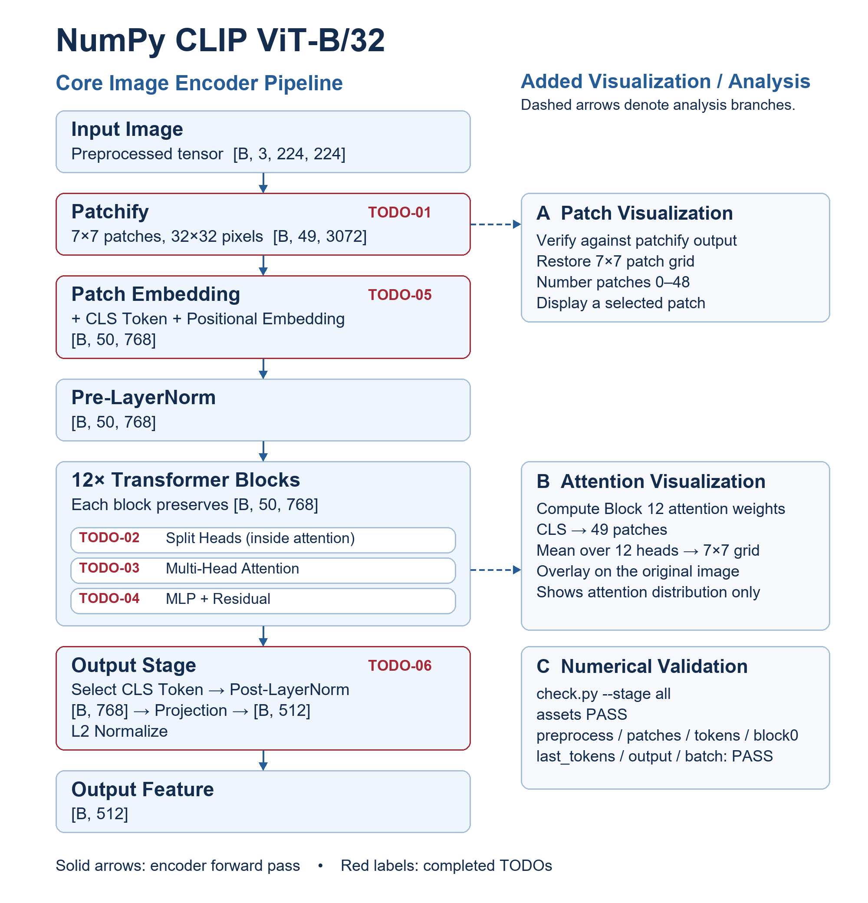

# 基于 NumPy 的 CLIP 图像编码器实现与可视化分析

深圳大学 Python Programming 课程实验项目

## 1. 项目简介

本实验使用 NumPy 实现 CLIP ViT-B/32 图像编码器的前向计算，从预处理后的图像提取 512 维特征，并通过课程参考结果验证各阶段的计算。模型参数由课程材料提供，实验只进行推理。

## 2. 项目功能

**原始作业功能**

- 将 224×224 RGB 图像切分为 49 个 32×32 Patch，按从左到右、从上到下的顺序排列。
- 将每个 Patch 投影为 768 维向量，在序列开头加入 CLS Token，再加上位置嵌入。
- 通过 12 个 Transformer Block 处理序列。每个 Block 包含 12 头注意力、MLP 和两次残差相加。
- 取最终 CLS Token，经过层归一化、线性投影和 L2 归一化，为每张图像输出一个 512 维特征。

**可视化与验证**

- 显示编号 0–48 的 7×7 Patch 网格，核对 Patch 顺序，并支持单独显示指定 Patch。
- 将最后一个 Transformer Block 的 CLS 注意力绘制成热力图。
- 使用课程提供的检查脚本逐阶段对比参考结果，并测试重排和重复图片的 Batch 推理。

## 3. 项目目录结构

~~~text
.
├── image_encoder.py           # 图像编码器及六处作业实现
├── helpers.py                 # LayerNorm、GELU、注意力系数等辅助计算
├── preprocess_image.py        # 图片缩放、中心裁剪和归一化
├── runtime.py                 # 加载参数、配置和图片
├── config.json                # 模型配置和权重路径
├── run.py                     # 执行推理并保存特征
├── check.py                   # 分阶段数值验证
├── requirements.txt          # Python 依赖
├── visualization/
│   ├── common.py
│   ├── visualize_patches.py
│   ├── visualize_attention.py
│   └── draw_model_pipeline.py
├── outputs/
│   ├── visualizations/        # Patch 网格、单个 Patch 和注意力热力图
│   └── report_figures/        # 模型整体流程图
└── IMPLEMENTATION_REPORT.md   # 实现细节和数值误差
~~~

## 4. 环境要求

本机全局环境为 Python **3.14.0**、NumPy **2.4.0**；项目 `.venv` 虚拟环境为 Python **3.14.0**、NumPy **2.5.4**。依赖范围以 `requirements.txt` 为准，包括 NumPy（≥1.24、<3）、Pillow（≥9.2、<13）和 imageio（≥2.31、<3）。

在 PowerShell 中进入解压后的项目目录。若当前位于项目的上一级目录，可运行：

~~~powershell
Set-Location .\project1-numpy-student
~~~

首次配置时创建虚拟环境并安装依赖。已有虚拟环境可从激活命令开始：

~~~powershell
python -m venv .venv
.\.venv\Scripts\Activate.ps1
python -m pip install -r requirements.txt
~~~

运行推理前，从课程材料准备 `weights/image_encoder.npz` 和 `assets/` 中的样图。运行数值检查还需要课程提供的参考输出和清单。保留课程附件中的相对目录结构。

## 5. 运行方法

在项目根目录运行以下命令，编码课程提供的十张样图，并将结果保存到 `outputs/output_tokens.npz`：

~~~powershell
python run.py --output outputs/output_tokens.npz
~~~

也可用 `--images` 指定一张或多张图片：

~~~powershell
python run.py --images assets/images/image_01.jpg --output outputs/image_01_tokens.npz
~~~

省略 `--output` 时，默认写入当前目录的 `output_tokens.npz`。文件包含图片标识 `ids` 和形状为 `[B, 512]` 的 `float32` 数组 `output_tokens`，其中 `B` 为图片数量。

## 6. 可视化运行方法

~~~powershell
# 生成 Patch 网格
python visualization/visualize_patches.py assets/images/image_01.jpg

# 生成网格，并单独展示编号 17 的 Patch
python visualization/visualize_patches.py assets/images/image_01.jpg --patch 17

# 生成 Attention 热力图
python visualization/visualize_attention.py assets/images/image_01.jpg

# 重新生成实验报告中的模型流程图
python visualization/draw_model_pipeline.py
~~~

前三个命令将图片保存到 `outputs/visualizations/`，流程图保存到 `outputs/report_figures/`。Patch 编号范围为 0–48。热力图对第 12 个 Block 中 CLS 到 49 个 Patch 的注意力在 12 个头上取平均，再将 7×7 网格叠加到原图对应区域。

## 7. 数值验证

~~~powershell
python check.py --stage all
python check.py --stage batch
~~~

| 阶段 | 检查内容 |
| --- | --- |
| `assets` | 权重、样图、模型配置与参考文件是否匹配 |
| `preprocess` | 图像预处理张量 |
| `patches` | Patch 形状、顺序和数值 |
| `tokens` | Patch 投影、CLS 和位置嵌入后的序列 |
| `block0` | 第一个 Transformer Block 的输出 |
| `last_tokens` | 12 个 Block 处理后的完整 Token 序列 |
| `output` | 十张样图的最终特征及其单位范数 |
| `batch` | 按索引 `[1, 0, 1]` 取样后的批量特征、顺序及单位范数 |

`all` 包括上述所有阶段。单独运行 `batch` 会先检查资源，再执行批量测试。数值比较通过表示输出形状和类型符合要求，数值有限，且与课程参考结果的差异在脚本容差内。

## 8. 实验结果

`all` 和单独的 `batch` 检查均通过。十张样图的输出形状是 `(10, 512)`，批量重排测试的输出形状是 `(3, 512)`。每一行是对应图片的 L2 归一化特征。

| 阶段 | 最大绝对误差 | 平均绝对误差 |
| --- | ---: | ---: |
| `output` | 5.439e-07 | 8.311e-08 |
| `batch` | 4.619e-07 | 7.632e-08 |

增加可视化前后，十张样图的特征逐元素一致。各阶段的误差和实现细节见[实现报告](IMPLEMENTATION_REPORT.md)。

## 9. 可视化效果

**模型主流程与扩展模块**

Patch 网格、单个 Patch 和注意力热力图可以使用第 6 节的命令在本地生成。现有示例图片使用课程提供的原始图片；公开展示许可尚待确认，因此未包含在仓库中。
## 10. 项目说明与局限性

本实验范围为使用课程提供的参数进行图像编码器前向计算，未实现文本编码器，也未进行模型训练。热力图用于观察指定层的注意力分布，不能作为模型输出的完整因果解释。

课程提交包括完成的 `image_encoder.py`、README 和实验报告。报告需记录各阶段误差、一个形状变化、一个实际修复的问题，以及个人贡献和使用的辅助。虚拟环境、课程数据、私人文件及大型预训练权重请留在本地。
